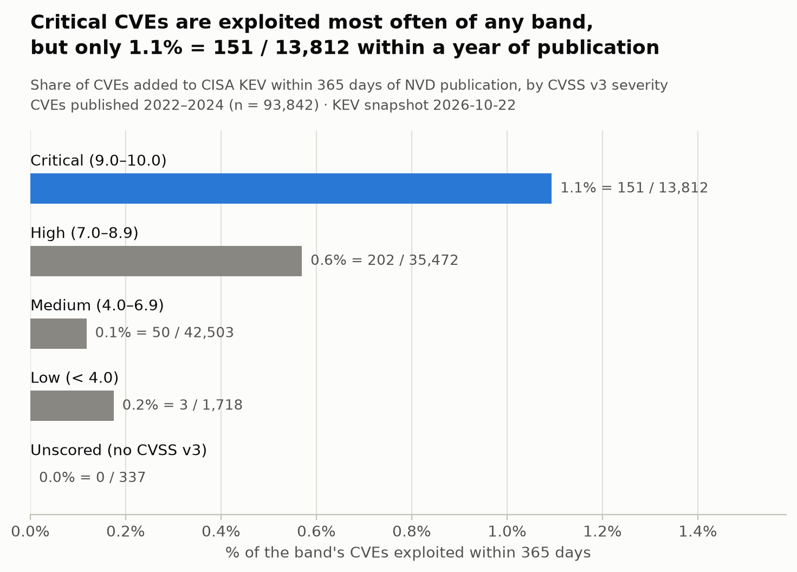
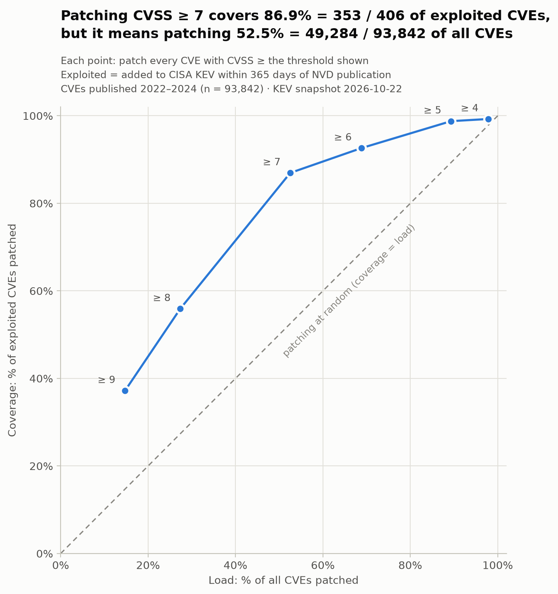
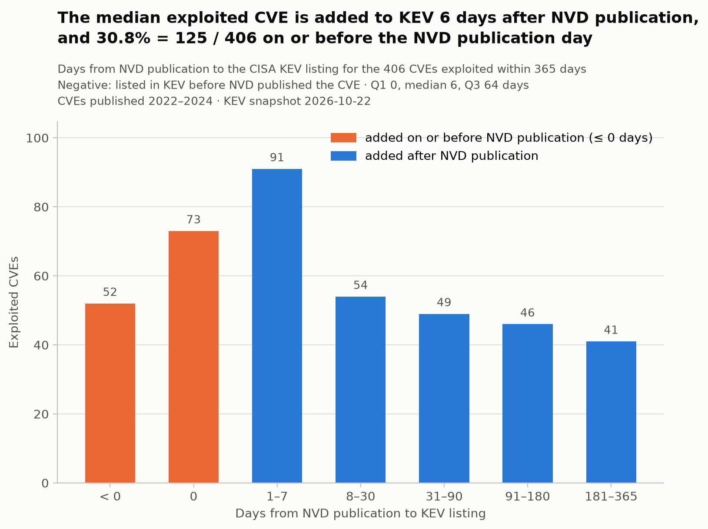
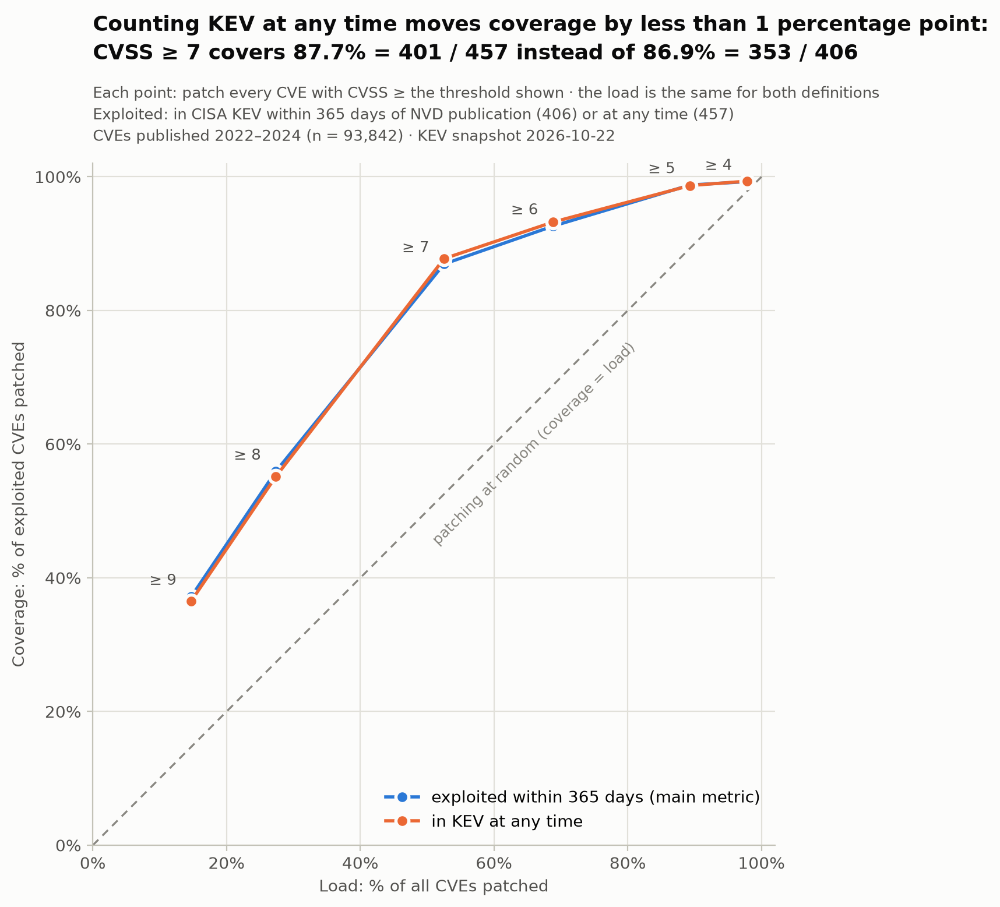

# Patch what matters: does CVSS tell us what to patch?

Security teams cannot patch every vulnerability, so many prioritize by CVSS score. This project tests that
rule against what attackers actually exploited: every CVE published in NVD from 2022 to 2024 (93,842 CVEs),
checked against the CISA Known Exploited Vulnerabilities (KEV) catalog.

**Short answer: CVSS helps, but it is a blunt tool.**

- Exploitation is rare in every severity band. Critical CVEs are exploited most often, yet only
  1.1% = 151 / 13,812 of them were added to KEV within a year of publication.
- Every CVSS threshold does better than patching at random, but coverage only gets high when the load is heavy.
  The usual CVSS ≥ 7 rule covers 86.9% = 353 / 406 of the exploited CVEs while patching
  52.5% = 49,284 / 93,842 of all CVEs. Patching only CVSS ≥ 9 cuts the load to 14.7% = 13,812 / 93,842
  but covers just 37.2% = 151 / 406.
- 53 exploited CVEs (13.1% = 53 / 406) have CVSS < 7, so a CVSS ≥ 7 rule never patches them.

## The business problem

Between 2022 and 2024, NVD published 93,842 CVEs (excluding *Rejected* ones). Only 0.4% = 406 / 93,842 were
added to KEV within 365 days of publication. A patching rule is useful if it puts those few exploited CVEs
first without asking the team to patch everything else. This project measures, for each CVSS threshold:

- **load**: the share of all CVEs the rule asks you to patch, and
- **coverage**: the share of exploited CVEs it patches.

## Connection with my bachelor's thesis

This project is the defender-side follow-up to my bachelor's thesis,
[SSH Honeypot with Real-Time Threat Dashboard](https://github.com/NicolaGarciaE/ssh-honeypot-threat-dashboard)
(Universidad de Alcalá, 2026). There I deployed an SSH honeypot on a public server and enriched every
connection with geolocation and IP reputation data; the traffic it captured was almost entirely automated
scanning and default-credential attempts. That project looked at who is attacking. This one asks what
defenders should patch first, using CISA's catalog of known exploited vulnerabilities as the ground truth.

## Data sources and snapshot date

| Source | What is used | Downloaded (UTC) |
| --- | --- | --- |
| [NVD CVE API 2.0](https://nvd.nist.gov/developers/vulnerabilities) | CVE records published 2022-01-01 to 2024-12-31, fetched in 10 windows of at most 120 days | 2026-10-22 (1 file) and 2026-10-23 (9 files) |
| [CISA KEV catalog](https://www.cisa.gov/known-exploited-vulnerabilities-catalog) (CSV) | `cveID`, `vendorProject`, `product`, `dateAdded`, `knownRansomwareCampaignUse`; 1,754 rows, of which 26.1% = 457 / 1,754 are CVEs in the universe | 2026-10-22 |

The download date is part of each raw file name. The analysis is a snapshot of those days: KEV and NVD
change over time.

## Key definitions

- **Universe**: CVEs whose NVD `published` date (UTC day) is between 2022-01-01 and 2024-12-31, both
  included, excluding `vulnStatus` *Rejected*. The filter uses the publication date, not the year in the
  CVE ID. 93,842 CVEs.
- **CVSS score**: the CVSS v3.1 base score, or v3.0 if there is no v3.1. Within that version, the entry of
  type *Primary* is preferred; if there is none, a *Secondary* one is used (when there are several, the one
  whose source matches the CVE's `sourceIdentifier`; no CVE needed the fallback to the first *Secondary*).
  The `type` field is taken literally: in 10 CVEs the *Primary* entry does not come from `nvd@nist.gov`.
  The version and source used are stored for every CVE. Scores used, from `src/quality_report.py`:

  | CVSS used | CVEs |
  | --- | --- |
  | v3.1 Primary | 77.6% = 72,835 / 93,842 |
  | v3.1 Secondary | 21.4% = 20,054 / 93,842 |
  | v3.0 Secondary | 0.7% = 616 / 93,842 |
  | no CVSS v3 (Unscored) | 0.4% = 337 / 93,842 |

- **Severity**: Critical ≥ 9.0, High 7.0–8.9, Medium 4.0–6.9, Low < 4.0.
- **Unscored**: CVEs without a CVSS v3.1 or v3.0 score. They are kept as their own group, not dropped.
  CVSS rules never patch them, but they count in every total. Per publication year, from
  `src/quality_report.py`:

  | Year | Unscored |
  | --- | --- |
  | 2022 | < 0.1% (12 / 25,073) |
  | 2023 | < 0.1% (1 / 28,816) |
  | 2024 | 0.8% = 324 / 39,953 |
  | Total | 0.4% = 337 / 93,842 |

- **Exploited (main metric)**: the CVE is in KEV with `dateAdded` ≤ NVD publication day + 365 days. The
  window has ended for the whole universe: the last CVE was published on 2024-12-31, its window ended on
  2025-12-31, and the earliest download was on 2026-10-22.
- **Sensitivity check**: questions 1 and 2 are repeated with *exploited = in KEV at any time*.
- **Days to KEV**: KEV `dateAdded` minus the NVD publication day. Values of 0 or below are kept and counted
  apart. They are **not** zero-days: the clock starts at NVD publication, not at first exploitation.
- **Vendor and product**: KEV's `vendorProject` and `product`, not normalized.

## Findings

All numbers come from [`notebooks/analysis.ipynb`](notebooks/analysis.ipynb).

### 1. How often is each severity exploited?



| Severity | CVEs | Exploited within 365 days |
| --- | ---: | --- |
| Critical (9.0–10.0) | 13,812 | 1.1% = 151 / 13,812 |
| High (7.0–8.9) | 35,472 | 0.6% = 202 / 35,472 |
| Medium (4.0–6.9) | 42,503 | 0.1% = 50 / 42,503 |
| Low (< 4.0) | 1,718 | 0.2% = 3 / 1,718 |
| Unscored (no CVSS v3) | 337 | 0.0% = 0 / 337 |
| Total | 93,842 | 0.4% = 406 / 93,842 |

Critical CVEs are exploited about twice as often as High ones, and the share falls with severity down to
Medium (the Low share rests on only 3 CVEs). Still, 98.9% = 13,661 / 13,812 of Critical CVEs were not
exploited within a year, so a Critical score on its own says little about which CVEs will be exploited.

### 2. Patching load vs coverage by CVSS threshold



Each rule is *patch every CVE with CVSS ≥ threshold*.

| Rule | Load: patched / all CVEs | Coverage: patched / exploited CVEs |
| --- | --- | --- |
| CVSS ≥ 9 | 14.7% = 13,812 / 93,842 | 37.2% = 151 / 406 |
| CVSS ≥ 8 | 27.4% = 25,674 / 93,842 | 55.9% = 227 / 406 |
| CVSS ≥ 7 | 52.5% = 49,284 / 93,842 | 86.9% = 353 / 406 |
| CVSS ≥ 6 | 68.8% = 64,566 / 93,842 | 92.6% = 376 / 406 |
| CVSS ≥ 5 | 89.3% = 83,811 / 93,842 | 98.8% = 401 / 406 |
| CVSS ≥ 4 | 97.8% = 91,787 / 93,842 | 99.3% = 403 / 406 |

53 exploited CVEs (13.1% = 53 / 406) have CVSS < 7 and none is Unscored. Catching almost all of them with
CVSS ≥ 5 (98.8% = 401 / 406) means patching 89.3% = 83,811 / 93,842 of all CVEs.

### 3. Who gets exploited, ransomware use and days from NVD publication to KEV

Population: the 406 CVEs exploited within 365 days.

The exploited CVEs are concentrated in a few vendors, out of 96 with at least one exploited CVE. These are
**shares of the exploited CVEs, not exploitation rates**: vendor and product come from KEV, so they are
unknown for CVEs outside it.

| Vendor | Share of exploited CVEs |
| --- | --- |
| Microsoft | 19.7% = 80 / 406 |
| Apple | 8.6% = 35 / 406 |
| Google | 6.4% = 26 / 406 |
| Cisco | 3.7% = 15 / 406 |
| Ivanti | 3.2% = 13 / 406 |

| Vendor and product | Share of exploited CVEs |
| --- | --- |
| Microsoft Windows | 12.1% = 49 / 406 |
| Apple Multiple Products | 5.4% = 22 / 406 |
| Google Chromium V8 | 3.4% = 14 / 406 |
| Linux Kernel | 2.2% = 9 / 406 |
| Synacor Zimbra Collaboration Suite (ZCS) | 2.0% = 8 / 406 |

25.4% = 103 / 406 of the exploited CVEs have known ransomware campaign use in KEV.



The median exploited CVE was added to KEV 6 days after its NVD publication date (Q1 0, Q3 64; min −290,
max 359). 30.8% = 125 / 406 were added on or before that date:

| Days from NVD publication to KEV | Exploited CVEs |
| --- | --- |
| < 0 (in KEV before NVD publication) | 12.8% = 52 / 406 |
| 0 (same day) | 18.0% = 73 / 406 |
| > 0 (after NVD publication) | 69.2% = 281 / 406 |

### 4. Sensitivity check: exploited = in KEV at any time



Counting every CVE in the KEV snapshot gives 457 exploited CVEs instead of 406; 51 were added to KEV more
than 365 days after publication. The conclusions do not change:

- The severity bands keep the same order (Critical > High > Low > Medium > Unscored). Critical becomes
  1.2% = 167 / 13,812 and High 0.7% = 234 / 35,472.
- Coverage moves by less than one percentage point at every threshold: CVSS ≥ 7 covers
  87.7% = 401 / 457 instead of 86.9% = 353 / 406, and 12.3% = 56 / 457 of the exploited CVEs still have
  CVSS < 7.
- The 51 late additions are mostly High or Critical: 94.1% = 48 / 51 have CVSS ≥ 7 (16 Critical, 32 High, 3 Medium).

## Limitations

- **KEV is not all exploitation.** KEV only includes exploitation that is confirmed and known to CISA: a CVE
  that is not in KEV may still have been exploited.
- **The results depend on CVSS v3 coverage in NVD and on how unscored CVEs are treated.** 0.4% = 337 / 93,842
  of the CVEs have no CVSS v3 score, almost all of them published in 2024 (see the table above), and
  21.4% = 20,054 / 93,842 plus 0.7% = 616 / 93,842 use a *Secondary* score. In 693 CVEs, NVD also scored the
  same CVSS version but its score was not the one used; 10 of them are in KEV, and for 2 of those
  (CVE-2022-41080 and CVE-2023-26360) NVD's score would move them from High to Critical.
- **This is a snapshot.** KEV and NVD change over time; the results describe the download dates above.
- **Late KEV additions lean towards older CVEs.** The sensitivity check adds 51 CVEs listed in KEV more than
  365 days after publication. A CVE published in 2022 has had more time after its 365-day window to be added
  than one published in 2024, so the 'any time' definition structurally favors older CVEs; the size of this
  bias is not measured here.
- **The NVD publication date is not the start of exploitation.** 125 CVEs have days to KEV ≤ 0, and 52 of
  them were in KEV before NVD published them. Days to KEV measure the gap from NVD publication, not from
  first exploitation, so they are not zero-day counts.
- **Vendor counts are shares, not rates.** Vendor and product exist only for CVEs in KEV, so the tables show
  each vendor's share of the exploited CVEs, not how often its CVEs get exploited.

## Next step: add EPSS

The [Exploit Prediction Scoring System (EPSS)](https://www.first.org/epss/), maintained by the EPSS Special
Interest Group at FIRST, estimates the probability that a CVE will be exploited in the wild in the next
30 days and is updated daily. The next step is to put EPSS thresholds on the same load vs coverage chart as
CVSS. To keep the comparison fair, each CVE should get the EPSS score from around its publication date, not
today's, which already reflects exploitation seen since then.

## How to reproduce

`data/raw/` and `data/processed/cves.duckdb` are not in git, so the data has to be downloaded and the dataset
rebuilt. With a later download date the results will differ slightly, because KEV and NVD change over time.

Requirements: Git, [uv](https://docs.astral.sh/uv/), the GitHub CLI (`gh`) and an [NVD API key](https://nvd.nist.gov/developers/request-an-api-key). Commands are
for PowerShell on Windows.

1. Clone the repository and install Python 3.14 and the locked dependencies (including the `dev` group,
   used to run the notebook):

   ```powershell
   gh repo clone NicolaGarciaE/patch-what-matters
   cd patch-what-matters
   uv sync
   ```

2. Create a file named `.env` in the project root with one line (it is in `.gitignore`, never commit it):

   ```
   NVD_API_KEY=your-api-key
   ```

3. Download the data. Both scripts skip files that already exist, so an interrupted download can be resumed
   by running them again. The NVD download waits 6 seconds between requests and can take hours.

   ```powershell
   uv run python src/download_kev.py
   uv run python src/download_nvd.py
   ```

4. Validate the raw files, build the dataset and print the quality report:

   ```powershell
   uv run python src/validate_raw.py
   uv run python src/build_dataset.py
   uv run python src/quality_report.py
   ```

5. Run the notebook top to bottom. Its outputs are saved back into `notebooks/analysis.ipynb`:

   ```powershell
   uv run python src/run_notebook.py notebooks/analysis.ipynb
   ```

   The notebook keeps any figure that already exists in `reports/figures/`, so the committed figures are not
   redrawn. To redraw them with your data, set `OVERWRITE_FIGURES = True` in the notebook's first code cell.

Every script ends with automatic checks and a summary of counts, and stops if a check fails.
